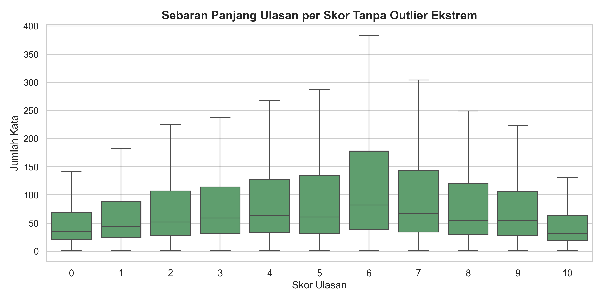

# Analisis Data Eksploratif Ulasan Pemain GTA VI

Proyek ini merupakan studi analisis deskriptif menggunakan ekosistem dasar Python yaitu **Pandas**, **Matplotlib**, dan **Seaborn** tanpa melibatkan algoritma pemrosesan bahasa alami tingkat lanjut. Analisis dilakukan terhadap **51.385 ulasan pemain** untuk memetakan pola distribusi skor, panjang tulisan, proporsi bahasa non-ASCII, serta topik utama pemicu sentimen positif maupun negatif.

## Pertanyaan Bisnis Utama

1. Bagaimana bentuk distribusi skor ulasan pemain pada skala 0 hingga 10?
2. Bagaimana hubungan antara skor yang diberikan dengan panjang teks ulasan?
3. Topik keluhan atau pujian apa saja yang paling memicu pemberian skor ekstrem 0 dan 10?
4. Bagaimana proporsi ulasan berbahasa non-ASCII atau non-Inggris di setiap tingkat skor?
5. Rekomendasi strategis apa yang dapat diambil oleh pihak pengembang dan pemangku kepentingan?

## Ringkasan Temuan Utama

- **Polarisasi Ekstrem atau Distribusi Bimodal:** Sebanyak **64.3%** ulasan terkonsentrasi pada dua kutub ekstrem, yakni **skor 10 sebanyak 18.097 ulasan** dan **skor 0 sebanyak 14.956 ulasan**, menghasilkan nilai rata-rata **5.00** dan median **4.0**. Secara keseluruhan, sentimen **Negatif pada skor 0 hingga 3 mencapai 46.5%**, sedikit melampaui sentimen **Positif pada skor 7 hingga 10 sebesar 43.8%**.
- **Ulasan Paling Kritis Berada di Skor Menengah:** Panjang ulasan membentuk pola kurva melengkung dengan puncak pada kelompok **Netral skor 4 hingga 6 sebesar rata-rata 118.3 kata**. Sebaliknya, pemberi skor 0 rata-rata hanya menulis **63.7 kata** dan skor 10 hanya **59.0 kata**, menandakan kutub ekstrem didominasi reaksi emosional singkat sementara skor menengah memuat evaluasi yang jauh lebih objektif dan terperinci.
- **Pemicu Utama Skor 0:** Ketidakpuasan pada skor 0 paling banyak menyoroti aspek **Gameplay sebesar 39.4%** dan **Cerita atau Story sebesar 32.4%**, diikuti keluhan teknis **Performa atau FPS sebesar 22.1%**, **Harga atau Refund sebesar 21.2%**, **Bug atau Glitch sebesar 20.9%**, serta penolakan terhadap **Isu Sosial atau Woke sebesar 17.5%**.
- **Dukungan Kuat Komunitas Internasional:** Sebanyak **40.03%** ulasan mengandung karakter non-ASCII yang didominasi pemain berbahasa Spanyol, Portugis, dan Italia. Proporsinya meningkat konsisten dari **32.36% pada skor 0** menjadi **47.29% pada skor 10**.

## Visualisasi Utama

### Distribusi Skor Ulasan


### Sebaran Panjang Ulasan per Skor



### Heatmap Topik Keluhan dan Pujian per Skor


## Rekomendasi Actionable

1. **Prioritaskan Optimalisasi Performa dan Perbaikan Bug:** Fokuskan pembaruan teknis pada stabilitas _frame rate_ dan penanganan _crash_, mengingat **22.1% ulasan skor 0** mengeluhkan masalah FPS dan **20.9%** menyoroti _bug_.
2. **Evaluasi Desain Misi Pembuka dan Mekanik Gameplay:** Tinjau ulang tempo alur permainan pada jam-jam awal karena **39.4% ulasan skor 0** mengkritik aspek _gameplay_ yang dianggap kurang menarik.
3. **Jadikan Ulasan Skor 4 hingga 7 sebagai Referensi Utama Riset Pengguna:** Gunakan ulasan kelompok menengah yang rata-rata mencapai **118.3 kata** sebagai sumber masukan utama karena berisi analisis kelebihan dan kekurangan game secara paling seimbang.
4. **Pertahankan Kualitas Lokalisasi Pasar Internasional:** Jaga dukungan bahasa dan server wilayah berbahasa Spanyol, Portugis, dan Italia yang menyumbang proporsi besar pada skor 10.

## Struktur Proyek

```text
gta-vi-descriptive-analytics/
├── data/
│   ├── raw/                        # Dataset mentah awal
│   └── processed/                  # Dataset bersih berformat Parquet
├── images/                         # Hasil analisis
├── notebooks/
│   ├── 01_eda_eksplorasi.ipynb     # Eksplorasi lengkap Phase 1 hingga 5
│   └── 02_final_report.ipynb       # Laporan akhir
├── .gitignore                      # Konfigurasi file yang diabaikan Git
├── requirements.txt                # Daftar pustaka Python
└── README.md                       # Dokumentasi utama proyek
```

## Cara Menjalankan Proyek

1. Kloning repositori ini ke komputer lokal Anda:
   ```bash
   git clone https://github.com/sutarozu/gta-vi-descriptive-analytics.git
   cd gta-vi-descriptive-analytics
   ```
2. Buat dan aktifkan _virtual environment_, lalu instal seluruh pustaka yang diperlukan:
   ```bash
   python -m venv venv
   venv\Scripts\activate
   pip install -r requirements.txt
   ```
3. Jalankan Jupyter Lab dan buka file `notebooks/02_final_report.ipynb`:
   ```bash
   jupyter lab
   ```
