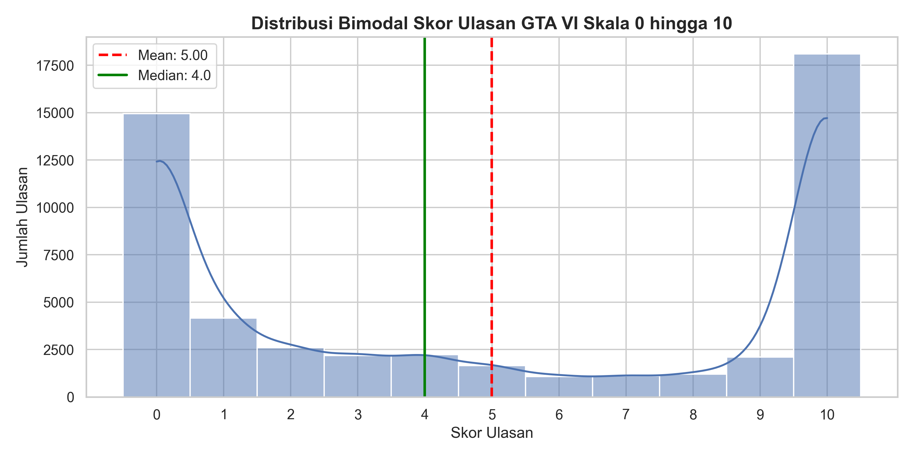
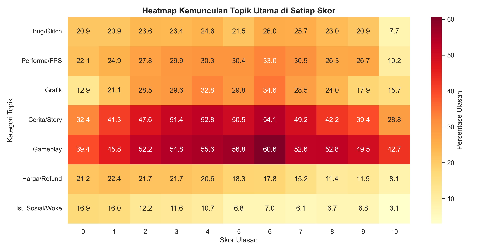

# Exploratory Data Analysis of GTA VI Player Reviews

This project is a descriptive analytics study built using the core Python ecosystem consisting of **Pandas**, **Matplotlib**, and **Seaborn** without involving advanced natural language processing algorithms. The analysis evaluates **51,385 player reviews** to map score distributions, review length patterns, non-ASCII language proportions, and key topics driving positive or negative sentiment.

## Key Business Questions

1. What is the shape of the player review score distribution on a 0 to 10 scale?
2. What is the relationship between the given score and the length of the review text?
3. Which complaint or praise topics most strongly trigger extreme scores of 0 and 10?
4. What is the proportion of non-ASCII or non-English reviews at each score level?
5. What strategic recommendations can be drawn for the developers and stakeholders?

## Summary of Key Findings

- **Extreme Polarization or Bimodal Distribution:** A total of **64.3%** of all reviews are concentrated at the two extreme poles, namely **score 10 with 18,097 reviews** and **score 0 with 14,956 reviews**, resulting in a mean score of **5.00** and a median of **4.0**. Overall, **Negative sentiment across scores 0 to 3 reaches 46.5%**, slightly exceeding **Positive sentiment across scores 7 to 10 at 43.8%**.
- **Most Critical Reviews Appear in Mid-Range Scores:** Review length follows a curved pattern peaking in the **Neutral group across scores 4 to 6 with an average of 118.3 words**. Conversely, reviewers giving a score of 0 write an average of only **63.7 words** and score 10 only **59.0 words**, indicating that extreme poles are dominated by brief emotional reactions while mid-range scores contain far more objective and detailed evaluations.
- **Primary Triggers for Score 0:** Dissatisfaction in 0-score reviews most frequently highlights **Gameplay at 39.4%** and **Story at 32.4%**, followed by technical complaints regarding **Performance or FPS at 22.1%**, **Price or Refund at 21.2%**, **Bugs or Glitches at 20.9%**, and pushback against **Social or Woke themes at 17.5%**.
- **Strong Support from International Communities:** Exactly **40.03%** of reviews contain non-ASCII characters dominated by Spanish, Portuguese, and Italian players. This proportion rises consistently from **32.36% at score 0** to **47.29% at score 10**.

## Key Visualizations

### Review Score Distribution



### Review Length Distribution per Score


### Heatmap of Complaint and Praise Topics per Score



## Actionable Recommendations

1. **Prioritize Performance Optimization and Bug Fixes:** Focus technical updates on _frame rate_ stability and _crash_ resolution, considering **22.1% of 0-score reviews** complain about FPS issues and **20.9%** highlight _bugs_.
2. **Evaluate Opening Mission Design and Gameplay Mechanics:** Reassess game pacing during the initial hours since **39.4% of 0-score reviews** criticize _gameplay_ aspects deemed unengaging.
3. **Use Scores 4 to 7 as the Primary Reference for User Research:** Utilize mid-range reviews averaging **118.3 words** as the main feedback source because they present the most balanced analysis of the game's strengths and weaknesses.
4. **Maintain Localization Quality for International Markets:** Preserve language support and regional servers for Spanish, Portuguese, and Italian markets that contribute a large proportion of 10-score reviews.

## Project Structure

```text
gta-vi-descriptive-analytics/
├── data/
│   ├── raw/                        # Initial raw dataset
│   └── processed/                  # Cleaned dataset in Parquet format
├── images/                         # High-resolution charts from analysis
├── notebooks/
│   ├── 01_eda_eksplorasi.ipynb     # Full exploratory workbook Phase 1 to 5
│   └── 02_final_report.ipynb       # Final report and storytelling Phase 6
├── .gitignore                      # Git ignored files configuration
├── requirements.txt                # Python dependencies list
└── README.md                       # Main project documentation
```

## How to Run the Project

1. Clone this repository to your local machine:
   ```bash
   git clone https://github.com/sutarozu/gta-vi-descriptive-analytics.git
   cd gta-vi-descriptive-analytics
   ```
2. Create and activate a _virtual environment_, then install all required libraries:
   ```bash
   python -m venv venv
   venv\Scripts\activate
   pip install -r requirements.txt
   ```
3. Launch Jupyter Lab and open the `notebooks/02_final_report.ipynb` file:
   ```bash
   jupyter lab
   ```
